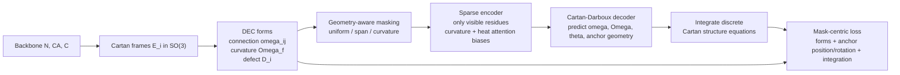

# Cartan-DEC-MiAE

Independent PyTorch implementation of **Cartan-DEC-MiAE**: self-supervised
protein-structure representation learning with Cartan moving frames and
discrete exterior calculus (DEC).

The method is described in the ScientistTwo paper
*[Cartan Moving Frames and Discrete Exterior Calculus for Self-Supervised
Protein Structure Representation](https://scientist-two.github.io/#applications/Health%20(Cartan-DEC-MiAE))*.
The data and MiAE ecosystem come from the open-source
**[TEDBench](https://github.com/BorgwardtLab/TEDBench)** project.

This repository provides a complete, runnable pipeline:

* residue frames from backbone `N, CA, C`;
* discrete connection 1-forms, curvature 2-forms and curvature/holonomy defects;
* a sparse, gauge-invariant Transformer encoder with curvature and connection
  heat-transport attention biases;
* a Cartan–Darboux decoder that predicts forms and integrates them back to 3D
  geometry;
* geometry-aware and contiguous-span masking;
* mask-centric loss and a frozen-encoder MLP probe;
* synthetic CPU demo plus adapters for the TEDBench Hugging Face datasets.

> **Scope.** This is an independent reimplementation, not the authors' original
> code. The full paper trains a 38M-parameter encoder on 369,740 structures. The
> checked-in quickstart uses small synthetic backbones so it runs on a laptop.
> See [Fidelity notes](#fidelity-notes) for the exact deviations.

## Method at a glance



For a contact triangle `(i, j, k)`:

```text
omega_ij = log(E_i^T E_j)
Omega_f  = omega_ij + omega_jk + omega_ki + 1/2 [omega_ij, omega_jk]
```

and for a masked residue `m` anchored at visible residue `a(m)`:

```text
E_m = E_a exp(sum_{u=a(m)}^{m-1} omega_u)
t_m = t_a + sum_{u=a(m)}^{m-1} E_u theta_u
```

The full derivation and implementation notes are in
[`docs/method.md`](docs/method.md).

## Installation

Python 3.10+ and PyTorch 2.1+ are required.

```bash
git clone https://github.com/l1Ha/cartan-dec-miae.git
cd cartan-dec-miae

# CPU-only PyTorch (choose the CUDA build from pytorch.org for a GPU)
pip install torch --index-url https://download.pytorch.org/whl/cpu

# Package + probe/metrics extras
pip install -e ".[probe]"

# Optional: Hugging Face datasets for TEDBench
pip install -e ".[data]"
```

Or install everything at once:

```bash
pip install -r requirements.txt
pip install -e ".[probe,data,dev]"
```

## Quickstart (CPU)

The quickstart trains a 1.2M-parameter model on synthetic helix/sheet/coil/
globule backbones, then freezes the encoder and trains the paper-style
mean+max MLP probe.

```bash
python scripts/quickstart.py
```

or with the module CLI:

```bash
python -m cartan_dec.train \
    --dataset synthetic --samples 128 --test-samples 64 \
    --epochs 3 --batch-size 16 \
    --d-model 128 --depth 4 --n-heads 8 \
    --decoder-dim 128 --decoder-depth 2 --decoder-heads 8 \
    --min-length 60 --max-synthetic-length 90 \
    --max-exact-heat-residues 96 \
    --probe-epochs 30 --out runs/quickstart
```

The demo is not a scientific benchmark; it verifies that geometry, masking,
forms, integration, pretraining and probing are all wired correctly. On the
synthetic task above the frozen probe reaches **98.4% accuracy / 0.984 macro
F1** on 64 held-out chains (4 classes) after ~13 seconds of CPU pretraining.

## Training on TEDBench

The public datasets are loaded from Hugging Face:

| Dataset | Repo | Split |
|---|---|---|
| TEDBench train | `TEDBench/ted` | `train` |
| TEDBench test | `TEDBench/ted` | `test` |
| External CATH 4.4 | `TEDBench/cath` | `test` |

Full-scale pretraining (369,740 structures, 965 CATH-T classes):

```bash
python -m cartan_dec.train \
    --dataset tedbench \
    --repo-id TEDBench/ted --train-split train \
    --test-repo-id TEDBench/ted --test-split test \
    --epochs 5 --batch-size 32 \
    --d-model 512 --depth 12 --n-heads 8 \
    --decoder-dim 256 --decoder-depth 3 --decoder-heads 8 \
    --mask-strategy span --mask-ratio 0.5 \
    --out runs/tedbench
```

Evaluate a checkpoint on the external CATH 4.4 set:

```bash
python -m cartan_dec.evaluate \
    --checkpoint runs/tedbench/last.pt \
    --dataset tedbench \
    --repo-id TEDBench/ted --train-split train \
    --test-repo-id TEDBench/cath --test-split test \
    --batch-size 32 --probe-epochs 100 \
    --out runs/tedbench/cath_metrics.json
```

Useful ablations:

```bash
# vanilla contiguous span masking (strongest per the paper)
--mask-strategy span --span-length 10

# uniform random masking
--mask-strategy random

# curvature/holonomy-targeted masking (paper reports it does NOT beat span)
--mask-strategy geometry --hard-geometry-mask

# attention-bias variants
--no-curvature-bias
--no-heat-bias
--distance-bias

# loss-term leave-one-out
--lambda-curvature 0
--lambda-omega 0
--lambda-integration 0
```

## Repository layout

```text
cartan_dec/
├── geometry.py   # frames, contact graph, connection/curvature forms, heat kernel
├── masking.py    # random, span, curvature/holonomy masking
├── model.py      # sparse encoder, Cartan-Darboux decoder, full model
├── losses.py     # mask-centric form + anchor + integration losses
├── data.py       # synthetic backbones and TEDBench adapters
├── probe.py      # frozen-encoder MLP/linear probes
├── train.py      # pretraining CLI
├── evaluate.py   # checkpoint evaluation CLI
└── utils.py      # seeding, logging, checkpoints

scripts/quickstart.py   # CPU end-to-end demo
tests/                  # geometry, masking, model and integration tests
docs/method.md          # equations and fidelity notes
```

## Paper results (for reference)

The paper's full-corpus result (369,740 structures, matched encoder/data/steps/
probe) is reproduced here for context. These numbers are from the paper, not
from the synthetic quickstart in this repository.

| Pretraining condition | TEDBench acc | TEDBench F1 | CATH 4.4 acc | CATH 4.4 F1 |
|---|---:|---:|---:|---:|
| Random-init encoder | 40.13 | 9.69 | 30.49 | 10.24 |
| Vanilla MAE (from scratch) | 56.91 | 32.23 | 51.10 | 23.90 |
| Cartan-DEC objective | 59.30 | 37.73 | 61.79 | 34.94 |
| + curvature-biased attention | **60.18** | **39.30** | **64.12** | **37.93** |
| + holonomy-curvature masking | 57.58 | 30.13 | 64.45 | 34.18 |
| Public MiAE-B reference (our probe) | 74.20 | 57.79 | 86.09 | 66.73 |

Key takeaways from the paper:

* curvature 2-form supervision is the most valuable single loss term;
* combining curvature and connection-heat attention is the strongest attention
  variant and best resists attention collapse under aggressive masking;
* holonomy-targeted masking does **not** beat plain contiguous span masking;
* lower reconstruction RMSD anti-correlates with downstream transfer.

## Fidelity notes

* **Encoder.** The paper uses the ESM3/MiAE geometric-attention stack. This
  implementation uses a clean invariant-feature Transformer with the same
  sparse visible-only computation and the same curvature/heat biases. The
  encoder is modular and can be replaced.
* **Holonomy.** For frame-exact coordinates the group holonomy around a graph
  loop telescopes to the identity. The paper notes this explicitly. The
  implementation uses the non-abelian curvature norm `||Omega_i||` as the
  defect/localiser, which is the informative part of `Omega_f`.
* **Path integration.** Integration follows the sequence, which is always
  connected under span masking. A contact-graph shortest path is a natural
  extension and would use the same structure equations.
* **Heat kernel.** Exact matrix exponential up to 192 residues; a stable
  diffusion approximation beyond that. It only feeds an attention bias.
* **Scale.** The synthetic quickstart is a smoke test. Full-scale results
  require the TEDBench corpus and substantially more compute.

## Tests

```bash
pytest -q
```

The tests cover SO(3) exp/log round-trips, orthonormal frames, connection forms,
curvature shapes, heat-kernel shapes, exact path-integration reconstruction,
masking budgets, model forward/backward, and the geometry-masking path.

## Citation

If you use this implementation, please cite the method paper and TEDBench:

```bibtex
@article{nam2026scientisttwo,
  title   = {ScientistTwo: Pioneering the Human Knowledge Frontier with Autonomous AI},
  author  = {Nam, Jaehyun and Yoon, Jinsung and Pan, Yanzhou and Wang, Yubo and
             Meng, Rui and Ranganathan, Parthasarathy and Pfister, Tomas},
  journal = {arXiv preprint arXiv:2609.19644},
  year    = {2026}
}

@inproceedings{chen2026tedbench,
  title     = {Protein Fold Classification at Scale: Benchmarking and Pretraining},
  author    = {Chen, Dexiong and Manolache, Andrei and Niepert, Mathias and Borgwardt, Karsten},
  booktitle = {Proceedings of the 43rd International Conference on Machine Learning (ICML)},
  year      = {2026}
}
```

## Acknowledgements

* The method and paper are by the ScientistTwo authors (Google Cloud AI
  Research).
* Data, MiAE baselines and evaluation protocol come from
  [BorgwardtLab/TEDBench](https://github.com/BorgwardtLab/TEDBench) (BSD-3-Clause).
* This independent implementation is released under the MIT License.
